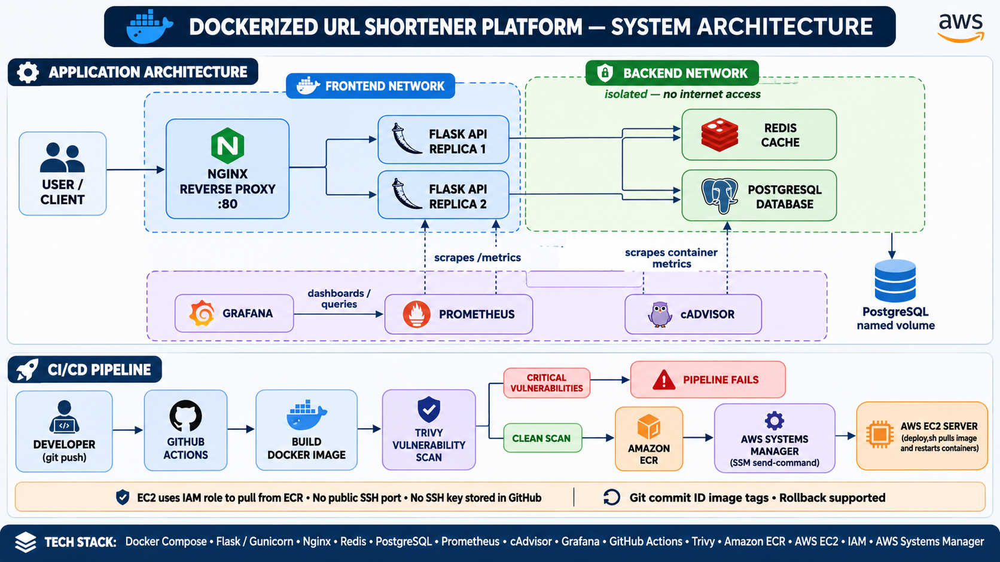
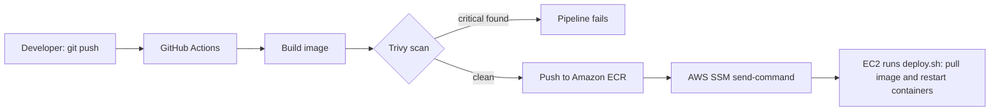
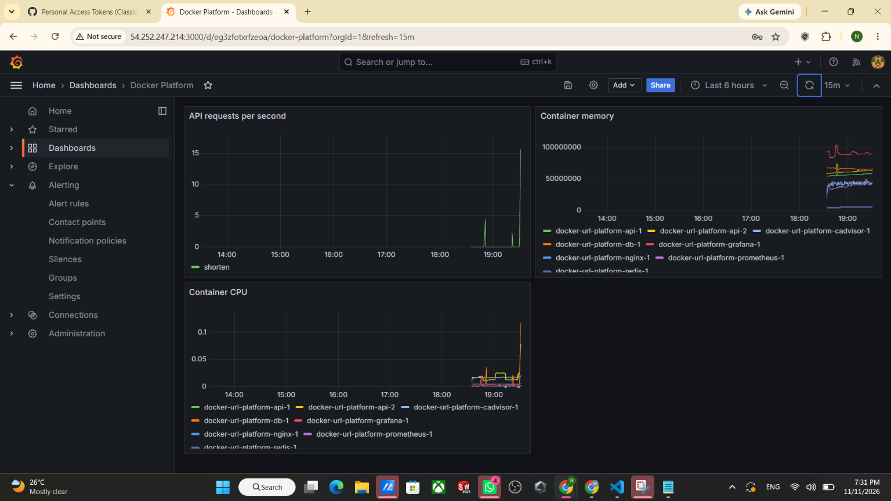
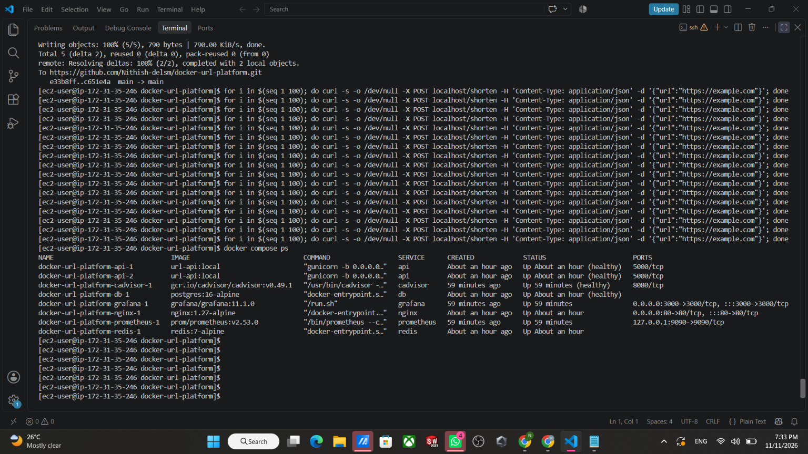

# Dockerized URL Shortener Platform

A multi-container microservices project built to learn Docker in depth, with a full CI/CD pipeline. Every `git push` builds the image, scans it for vulnerabilities, pushes it to Amazon ECR, and deploys it automatically to an AWS EC2 server.

## Architecture



Three Docker networks separate the layers: `frontend` (Nginx and API), `backend` (API, Redis, PostgreSQL; no internet access) and `monitoring` (API, Prometheus, cAdvisor, Grafana).

## CI/CD pipeline



- Images are tagged with the commit ID, so every release is traceable and can be rolled back.
- Deployment uses AWS Systems Manager instead of SSH, so no SSH port is exposed to the internet and no SSH key is stored in GitHub.
- The server pulls images using an IAM role, so no AWS keys are stored on it.


## Screenshots





## What this project demonstrates

- Multi-stage Dockerfile with a slim base image, layer caching and a non-root user (final image about 136 MB)
- Docker Compose with healthchecks, dependency ordering, resource limits and restart policies
- Network isolation: Nginx cannot reach the database (verified with `ping`)
- Persistent data with a named volume (links survive `docker compose down`)
- Two API replicas load-balanced by Nginx using Docker DNS
- Monitoring with Prometheus, cAdvisor and Grafana (dashboard exported in `monitoring/`)
- CI/CD with GitHub Actions, Trivy vulnerability scanning and Amazon ECR
- Automatic deployment to EC2 through AWS SSM, and rollback to any earlier image tag
- Secrets kept in `.env` and GitHub Secrets, never committed

## Verified behaviour

- Persistence: short links survive `docker compose down` and `up`, and are lost only with `down -v`
- Isolation: `ping` from Nginx to the API succeeds and to the database fails
- Release: a pushed code change appeared on the server automatically (health endpoint showed the new version)
- Rollback: deploying an older commit tag brought back the previous behaviour in seconds, and the next pipeline run rolled forward again
- Security gate: an image built from an outdated base image was blocked by Trivy before reaching ECR or the server

## Tech stack

Docker, Docker Compose, Python (Flask, Gunicorn), Nginx, Redis, PostgreSQL, Prometheus, cAdvisor, Grafana, GitHub Actions, Trivy, Amazon ECR, AWS EC2, IAM, AWS Systems Manager

## Project structure

```
api/                       Flask app, requirements.txt, Dockerfile
nginx/                     Nginx reverse proxy config
monitoring/                Prometheus config and Grafana dashboard JSON
docs/                      Screenshots
.github/workflows/ci.yml   CI/CD pipeline
deploy.sh                  Script run on the server to pull and restart
docker-compose.yml         The whole stack
```

## Run it locally

1. Create a `.env` file with: POSTGRES_DB, POSTGRES_USER, POSTGRES_PASSWORD, DB_NAME, DB_USER, DB_PASSWORD, DB_HOST=db, REDIS_HOST=redis
2. Start everything: `docker compose up -d --build`
3. Create a short link: `curl -X POST localhost/shorten -H 'Content-Type: application/json' -d '{"url":"https://example.com"}'`
4. Open it: `curl -i localhost/<code>`
5. Grafana runs on port 3000. Prometheus is bound to localhost:9090.

## API endpoints

- `POST /shorten` creates a short code for a URL
- `GET /<code>` redirects to the original URL
- `GET /health` health check
- `GET /metrics` Prometheus metrics

## Roadmap

- [x] Dockerized API with multi-stage build
- [x] Compose stack with Nginx, Redis, PostgreSQL
- [x] Monitoring with Prometheus, cAdvisor, Grafana
- [x] CI/CD with GitHub Actions, Trivy scan, Amazon ECR
- [x] Automatic deployment to EC2 with SSM
- [ ] Infrastructure as code with Terraform
- [ ] Health check that also verifies the database connection
