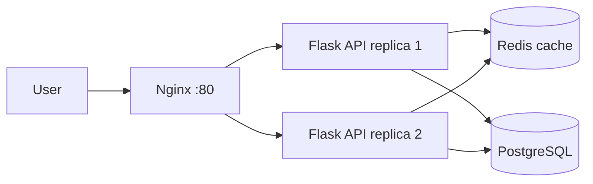

# Dockerized URL Shortener Platform

A multi-container microservices project built to learn Docker in depth: multi-stage builds, Docker Compose, networks, volumes, and healthchecks, running on an AWS EC2 server.

## Architecture



## Tech stack

Docker, Docker Compose, Python (Flask, Gunicorn), Nginx, Redis, PostgreSQL, AWS EC2

## What it demonstrates

- Multi-stage Dockerfile with a slim base image and a non-root user
- Healthchecks for the API and the database
- Three isolated networks: the database and cache are not reachable from the internet
- Persistent data using a named volume
- Two API replicas behind an Nginx load balancer
- Resource limits and restart policies
- Secrets kept in a `.env` file, excluded from Git

## Project structure

```
api/          Flask app, requirements.txt, Dockerfile
nginx/        Nginx reverse proxy config
monitoring/   Prometheus config (coming next)
docker-compose.yml
```

## Run it

1. Create a `.env` file with these keys: POSTGRES_DB, POSTGRES_USER, POSTGRES_PASSWORD, DB_NAME, DB_USER, DB_PASSWORD, DB_HOST=db, REDIS_HOST=redis
2. Start everything: `docker compose up -d --build`
3. Create a short link: `curl -X POST localhost/shorten -H 'Content-Type: application/json' -d '{"url":"https://example.com"}'`
4. Open it: `curl -i localhost/<code>`

## API endpoints

- `POST /shorten` creates a short code for a URL
- `GET /<code>` redirects to the original URL
- `GET /health` health check
- `GET /metrics` Prometheus metrics

## Roadmap

- [x] Dockerized API with multi-stage build
- [x] Compose stack with Nginx, Redis, PostgreSQL
- [ ] Monitoring with Prometheus, cAdvisor, Grafana
- [ ] CI/CD with GitHub Actions, Trivy scan, Amazon ECR
- [ ] Infrastructure with Terraform and automatic deploy# docker-url-platform
