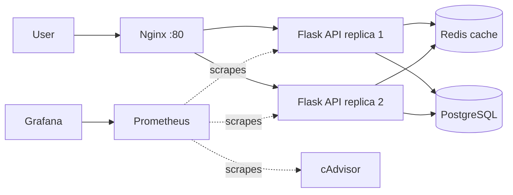
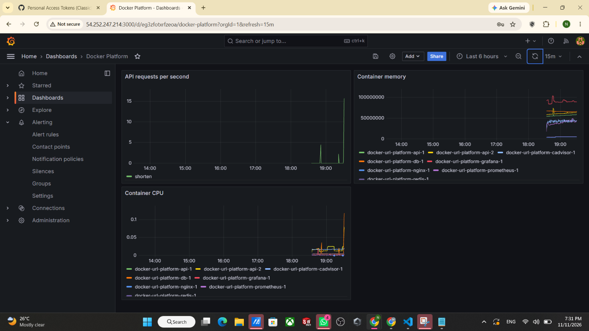
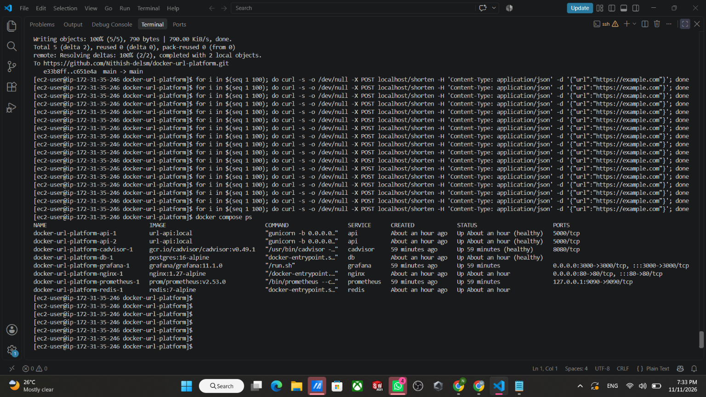

# Dockerized URL Shortener Platform

A multi-container microservices project built to learn Docker in depth. It runs on an AWS EC2 server with Docker Compose and includes a reverse proxy, a replicated API, a cache, a database, and a full monitoring stack.

## Architecture



Three Docker networks separate the layers: `frontend` (Nginx and API), `backend` (API, Redis, PostgreSQL; no internet access) and `monitoring` (API, Prometheus, cAdvisor, Grafana).

## Screenshots





## What this project demonstrates

- Multi-stage Dockerfile with a slim base image, layer caching and a non-root user (final image about 136 MB)
- Docker Compose with healthchecks, dependency ordering, resource limits and restart policies
- Network isolation: Nginx cannot reach the database (verified with `ping`)
- Persistent data with a named volume (links survive `docker compose down`)
- Two API replicas load-balanced by Nginx using Docker DNS
- Monitoring with Prometheus, cAdvisor and Grafana (dashboard exported in `monitoring/`)
- Secrets kept in a `.env` file that is excluded from Git

## Tech stack

Docker, Docker Compose, Python (Flask, Gunicorn), Nginx, Redis, PostgreSQL, Prometheus, cAdvisor, Grafana, AWS EC2

## Project structure

```
api/                       Flask app, requirements.txt, Dockerfile
nginx/                     Nginx reverse proxy config
monitoring/                Prometheus config and Grafana dashboard JSON
docs/                      Screenshots
docker-compose.yml         The whole stack
```

## Run it

1. Create a `.env` file with: POSTGRES_DB, POSTGRES_USER, POSTGRES_PASSWORD, DB_NAME, DB_USER, DB_PASSWORD, DB_HOST=db, REDIS_HOST=redis
2. Start everything: `docker compose up -d --build`
3. Create a short link: `curl -X POST localhost/shorten -H 'Content-Type: application/json' -d '{"url":"https://example.com"}'`
4. Open it: `curl -i localhost/<code>`
5. Grafana runs on port 3000. Prometheus is bound to localhost:9090.

## API endpoints

- `POST /shorten` creates a short code for a URL
- `GET /<code>` redirects to the original URL
- `GET /health` health check
- `GET /metrics` Prometheus metrics

## Dashboard queries

- Requests per second: `sum(rate(http_requests_total[1m])) by (endpoint)`
- Container memory: `sum by (name) (container_memory_usage_bytes{name=~".+"})`
- Container CPU: `sum by (name) (rate(container_cpu_usage_seconds_total{name=~".+"}[1m]))`

## Roadmap

- [x] Dockerized API with multi-stage build
- [x] Compose stack with Nginx, Redis, PostgreSQL
- [x] Monitoring with Prometheus, cAdvisor, Grafana
- [ ] CI/CD with GitHub Actions, Trivy scan, Amazon ECR
- [ ] Infrastructure with Terraform and automatic deploy
